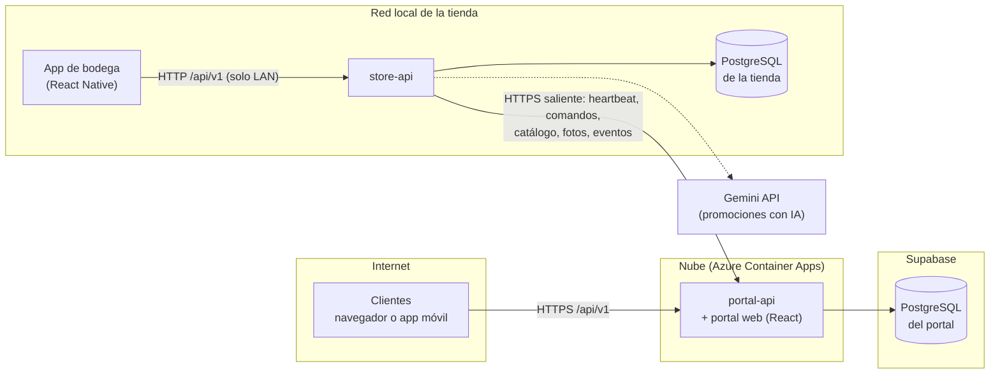
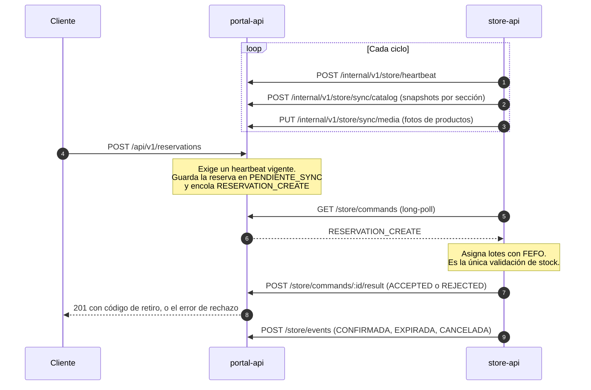
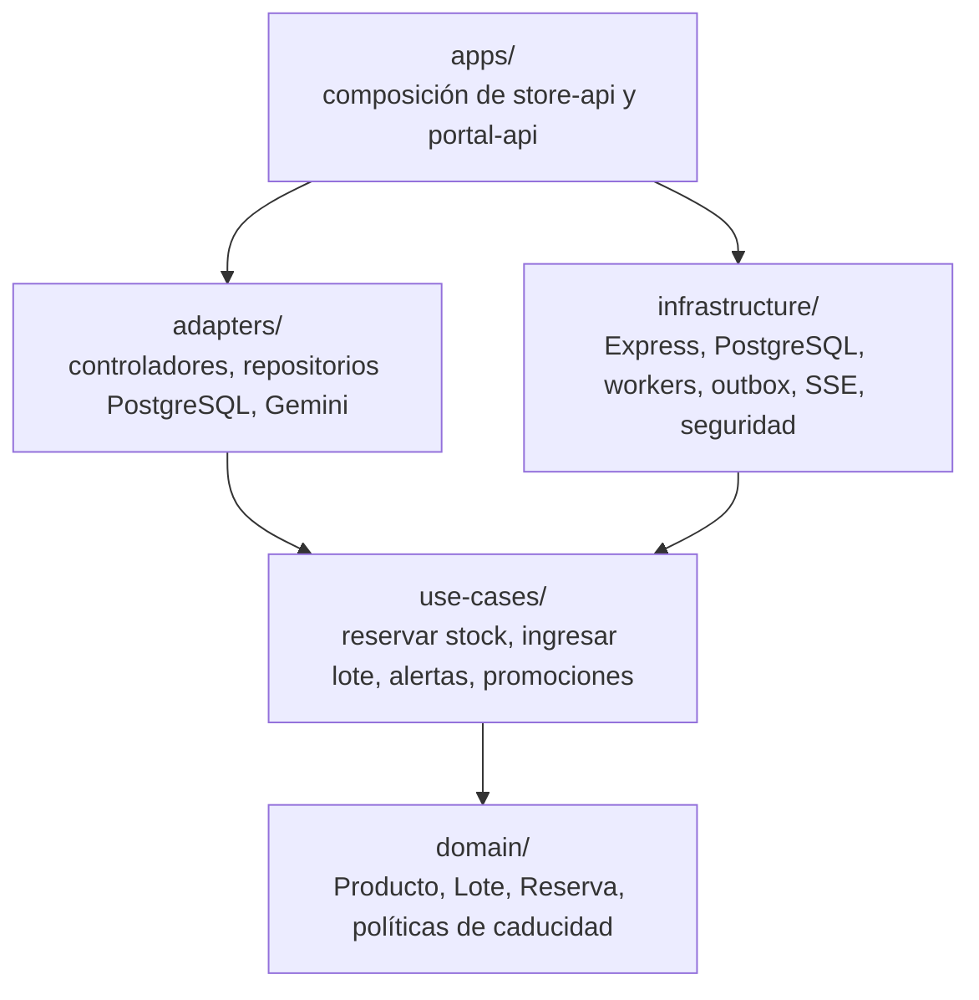

# Ecosistema Karen

Sistema de inventario por lotes y reservas para **Supermercado Karen**. Controla el stock por lote y
fecha de caducidad (principio **FEFO**: primero en vencer, primero en salir), avisa de los productos
próximos a caducar, genera promociones con IA y deja que los clientes reserven desde la web o el
móvil con un código de retiro para caja.

## Cómo se conecta todo

El backend está dividido en dos servicios con base de datos propia
([ADR-003](docs/decisions/ADR-003-split-store-portal.md)):

- **store-api** corre en la **PC de la tienda**, en la red local. Atiende solo al personal y es la
  única autoridad sobre inventario y reservas. Funciona aunque se caiga internet.
- **portal-api** corre en la **nube**. Atiende a los clientes y guarda una copia de lectura del
  catálogo. También sirve el portal web desde el mismo origen.

La tienda siempre inicia la comunicación (solo tráfico saliente): no se abren puertos hacia la PC.



| Pieza | Dónde corre | Habla con |
|---|---|---|
| `store-api` + su PostgreSQL | PC de la tienda (Docker) | el portal, saliendo por HTTPS |
| `portal-api` + portal web | Azure Container Apps | su PostgreSQL (Supabase) |
| App de bodega | Teléfonos del personal, en el Wi-Fi de la tienda | solo `store-api` |
| App del portal móvil y portal web | Clientes, por internet | solo `portal-api` |

### Roles

| Rol | Servicio | Qué hace |
|---|---|---|
| `CLIENTE` | portal-api | Se registra solo, consulta el catálogo y ofertas, reserva y cancela |
| `BODEGUERO`, `PERCHERO` | store-api | Ingresa lotes, mueve stock, confirma reservas en caja |
| `ADMIN` | store-api | Todo lo anterior, más productos, categorías, promociones y usuarios |

El personal no se registra por la API: se crea con `npm run user:create` en `backend/`.

### Sincronización entre tienda y portal



Si la tienda tarda más de 8 s en contestar, el portal responde `202` y el cliente consulta después.
Sin heartbeat vigente el portal no acepta reservas (`503`). El detalle completo, con estados,
reintentos e idempotencia, está en el [ADR-003](docs/decisions/ADR-003-split-store-portal.md).

## Estructura del repositorio

```
EcosistemaKaren/
├── backend/                       API Node.js + Express (store-api y portal-api)
│   ├── index.store.js             arranque de store-api (puerto 4000)
│   ├── index.portal.js            arranque de portal-api (puerto 4001)
│   ├── src/
│   │   ├── domain/                entidades y reglas de negocio (Producto, Lote, Reserva)
│   │   ├── use-cases/             casos de uso: auth, catálogo, lotes, promociones, reservas
│   │   ├── adapters/              controladores HTTP, repositorios PostgreSQL, adaptador de Gemini
│   │   ├── apps/                  composición de cada servicio (store, portal, shared)
│   │   └── infrastructure/        db, http, seguridad, workers, outbox, sync, heartbeat, SSE
│   ├── init-db/                   migraciones SQL: store/, portal/ y dev/ (datos de demostración)
│   ├── scripts/                   create-user, seed, verificaciones y pruebas de humo
│   └── test/                      pruebas con node:test
├── frontend/
│   ├── portal-web-react/          portal web para clientes (React + Vite + Tailwind, PWA)
│   ├── portal-mobile-reactnative/ app móvil de clientes (Expo)
│   └── bodega-mobile-reactnative/ app móvil del personal (Expo)
├── deploy/
│   ├── azure/                     Dockerfile.portal y deploy.ps1 para Azure
│   └── tienda/                    plantilla .env.store y scripts .bat de la PC de la tienda
├── docs/                          operación, Azure, apps móviles, decisiones (ADR) y más
├── docker-compose.prod.example.yml  despliegue de producción de store y portal
├── start.js                       levanta todo el entorno de desarrollo con un comando
├── architecture.md, database.md, api-spec.md   diseño del backend, esquema y API
└── CLAUDE.md                      flujo de trabajo Git del proyecto
```

### Capas del backend

La regla de dependencia va de afuera hacia adentro: las capas internas no conocen a las externas
(detalle en [architecture.md](architecture.md)).



### Procesos en segundo plano

| Servicio | Workers |
|---|---|
| store-api | `HeartbeatSenderWorker`, `CatalogSyncWorker`, `MediaSyncWorker`, `CommandPollerWorker`, `OutboxFlusherWorker`, `LotExpiryWorker`, `ReservationCleanerWorker`, `MaintenanceWorker` |
| portal-api | `PortalReservationSweeperWorker`, `MaintenanceWorker` |

## Tecnología

- **Backend:** Node.js (≥ 20), Express, PostgreSQL 14, JWT con cookie de sesión, Server-Sent Events para
  las alertas, Gemini para las promociones.
- **Web:** React, Vite, Tailwind, PWA con service worker.
- **Móviles:** React Native con Expo.
- **Infraestructura:** Docker; Azure Container Apps y Supabase en la nube.

## Desarrollo local

Requisitos: Node.js ≥ 20 y Docker.

```bash
node start.js            # dependencias, .env, PostgreSQL, datos de demostración, backend, web y Expo
node start.js --split    # igual, pero con store-api y portal-api separados, cada uno con su base
node start.js --down     # detiene PostgreSQL y pgAdmin
```

Cuentas de demostración (solo desarrollo): `cliente@karen.com`, `bodega@karen.com` y
`admin@karen.com`, todas con la contraseña `demo123`.

Puertos por defecto: store-api `4000`, portal-api `4001`, portal web `5175`, PostgreSQL de desarrollo
`5433` (portal `5434`).

Pruebas y verificaciones:

```bash
cd backend && npm test && npm run lint
cd frontend/portal-web-react && npm test && npm run lint && npm run build
npm test                 # en la raíz: pruebas del orquestador de desarrollo
```

Más detalle del backend en [backend/README.md](backend/README.md).

## Despliegue

| Qué | Dónde |
|---|---|
| Portal (API + web) en Azure, con la base en Supabase | [docs/azure.md](docs/azure.md) |
| PC de la tienda: variables, arranque y respaldos | `deploy/tienda/` y [docs/azure.md](docs/azure.md) |
| Operación: secretos, proxy, sondas, respaldos | [docs/operacion.md](docs/operacion.md) |
| Compilar las apps móviles | [docs/apps-moviles.md](docs/apps-moviles.md) |

Conexión a la base en la nube: `DB_HOST`, `DB_PORT`, `DB_NAME`, `DB_USER`, `DB_PASSWORD`, con
`DB_SSL=true` y, si el proveedor firma con su propia CA (Supabase), `DB_SSL_CA`. Con un pooler
(Supabase) usa el modo de sesión (puerto 5432), no el de transacción.

## Documentación

| Documento | Contenido |
|---|---|
| [architecture.md](architecture.md) | Arquitectura limpia del backend |
| [database.md](database.md) | Esquema de la base de datos |
| [api-spec.md](api-spec.md) | Especificación de la API |
| [diseno_interfaces.md](diseno_interfaces.md) | Diseño de las interfaces |
| [docs/decisions/](docs/decisions/) | Decisiones de arquitectura (ADR-001 a ADR-003) |
| [docs/sistema-visual.md](docs/sistema-visual.md) | Sistema visual de las apps |
| [docs/UAT-bodega.md](docs/UAT-bodega.md) | Pruebas de aceptación de la bodega |

## Flujo de trabajo con Git

Ramas: `main` (estable), `develop` (desarrollo) y ramas `feature/*`, `fix/*`, `refactor/*`, `chore/*`
y `docs/*` que salen de `develop`. Los commits siguen Conventional Commits. Ver [CLAUDE.md](CLAUDE.md).
