# 🛒 Ecosistema Karen

[](https://nodejs.org)
[](https://expressjs.com)
[](https://react.dev)
[](https://expo.dev)
[](https://www.typescriptlang.org)
[](https://www.postgresql.org)
[](https://www.docker.com)
[](https://azure.microsoft.com/products/container-apps)
[](LICENSE)

**Ecosistema Karen** es un sistema de inventario por lotes y reservas para **Supermercado Karen**. Controla el stock por lote y fecha de caducidad (principio **FEFO**: primero en vencer, primero en salir), avisa de los productos próximos a caducar, genera promociones con inteligencia artificial y deja que los clientes aparten productos desde la web o el móvil con un código de retiro para pagar en caja. Está pensado para el personal de bodega y caja de la tienda y para sus clientes.

El repositorio se desarrolló en equipo a partir del 15 de septiembre de 2026 (fecha del primer commit) e incluye el backend, el portal web, la app móvil de clientes y la app móvil de bodega. Los datos de ejemplo corresponden a un catálogo de productos que se comercializan en Ecuador.

> [!TIP]
> La forma más rápida de verlo funcionando es tener Node.js ≥ 20 y Docker instalados y ejecutar `node start.js` en la raíz: instala las dependencias, crea el `.env`, levanta PostgreSQL con datos de demostración, el backend, el portal web y Expo. Las cuentas de demostración están en la sección «Uso y Ejecución».

---

## 📖 Descripción

### ¿Qué problema resuelve?

Un supermercado pierde dinero cuando los productos caducan en la bodega sin que nadie lo note, y pierde ventas cuando el cliente llega y el producto ya se acabó. Además, controlar el inventario por lote y fecha en papel o en hojas de cálculo es lento y propenso a errores.

### ¿Qué hace?

1. El personal registra cada lote que llega (producto, fechas, cantidad y ubicación) escaneando el código de barras desde la app de bodega.
2. El sistema calcula los días que le quedan a cada lote y lo clasifica con un semáforo (vencido, rojo, amarillo o normal), avisando en tiempo real de lo que está por vencer.
3. Para un lote próximo a caducar, el personal pide a la IA una promoción; un administrador la revisa, fija sus límites y la aprueba antes de que los clientes la vean.
4. Los clientes consultan el catálogo y las ofertas desde el portal web o la app móvil, arman su lista y la apartan; el sistema les entrega un código de retiro.
5. La tienda reserva el stock con FEFO, retiene la reserva durante el tiempo elegido (30 minutos a 2 horas, ampliable) y la libera sola si el cliente no llega.
6. En caja se busca la reserva por su código y se confirma; cada movimiento queda registrado en el inventario y en los reportes.

### ¿Para quién está pensado?

- **Clientes** de la tienda: ven el catálogo y las ofertas, apartan productos y retiran sin hacer fila.
- **Personal de bodega y percha** (`BODEGUERO`, `PERCHERO`): reciben lotes, mueven stock, registran mermas y confirman reservas en caja.
- **Administradores** (`ADMIN`): gestionan productos, categorías, promociones, límites de las ofertas, reportes y usuarios.

---

## 📸 Capturas

Capturas tomadas con el proyecto corriendo en local, con la base de datos de ejemplo y a pantalla completa. Todos los datos mostrados son de demostración.

| | |
|:---:|:---:|
| 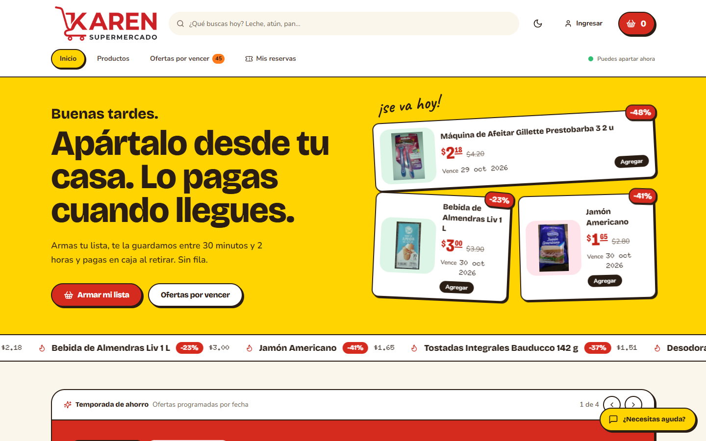<br><sub>Portal web: inicio con las ofertas del día</sub> | 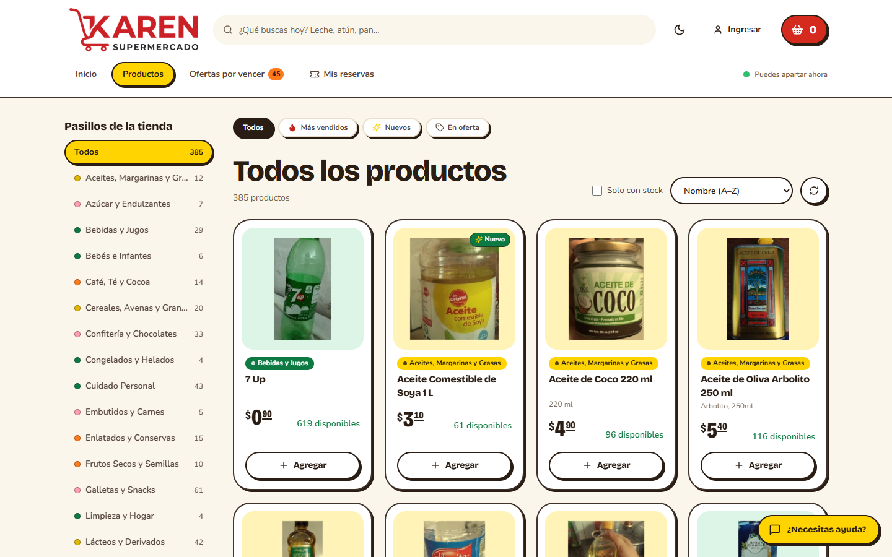<br><sub>Portal web: catálogo por pasillos, con filtros y orden</sub> |
| 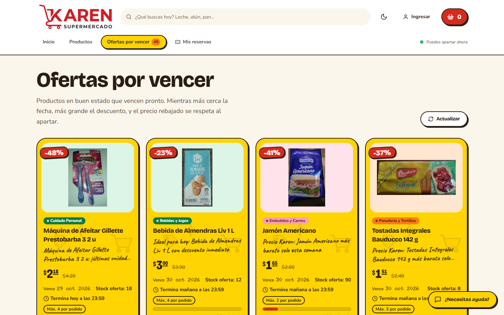<br><sub>Portal web: ofertas por vencer</sub> | 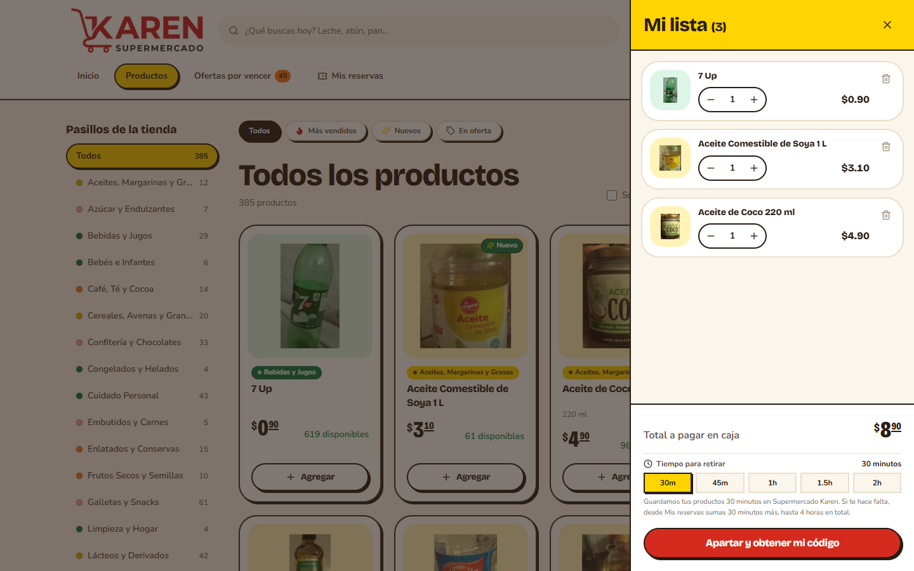<br><sub>Portal web: la lista del cliente y el tiempo de retiro</sub> |
| 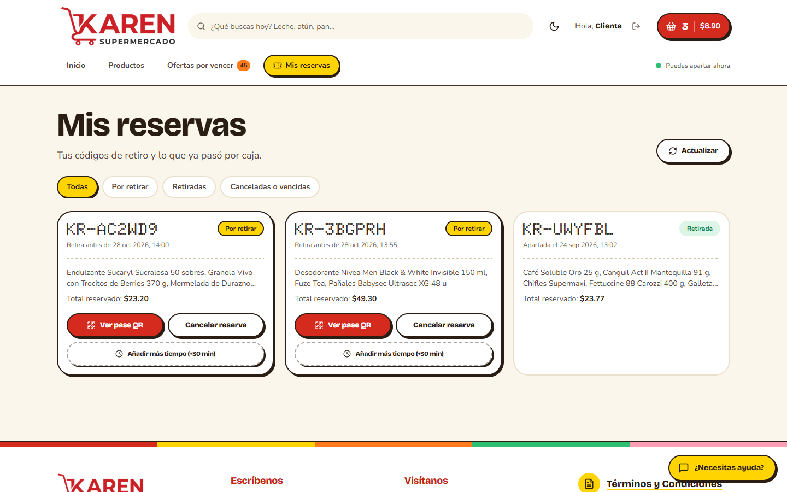<br><sub>Portal web: Mis reservas, con código de retiro y tiempo extra</sub> | 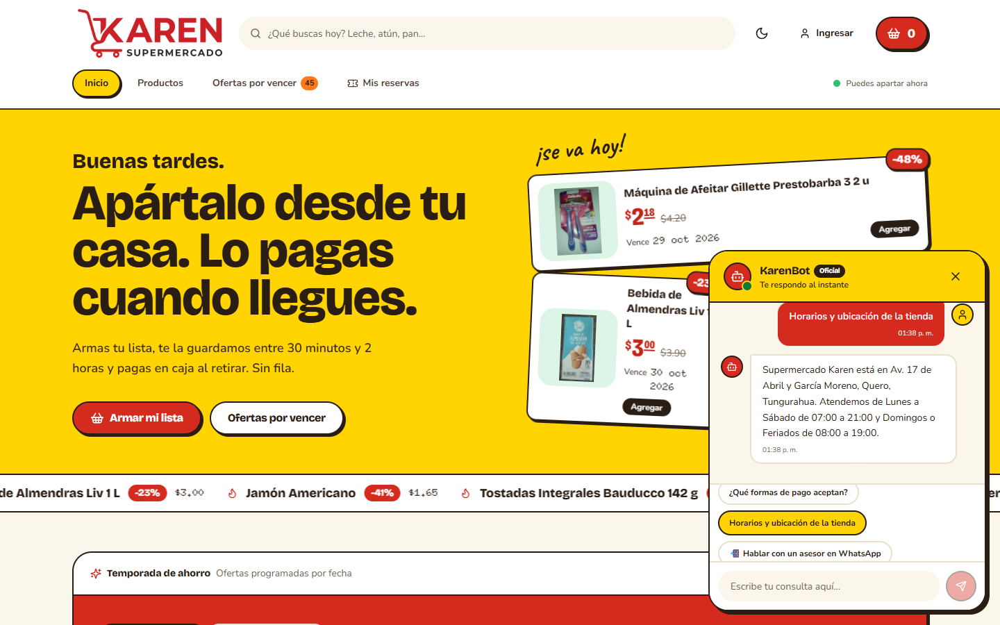<br><sub>Portal web: KarenBot responde preguntas frecuentes</sub> |
| 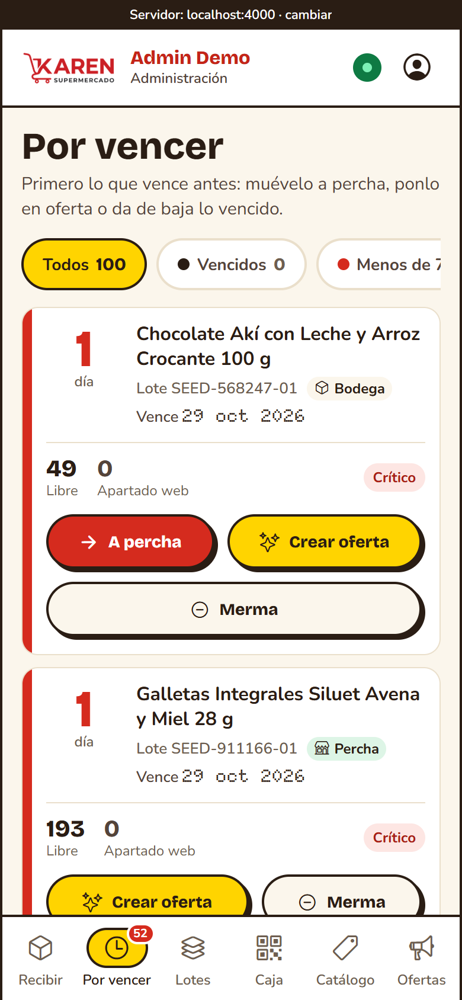<br><sub>App de bodega: lotes por vencer según FEFO</sub> | 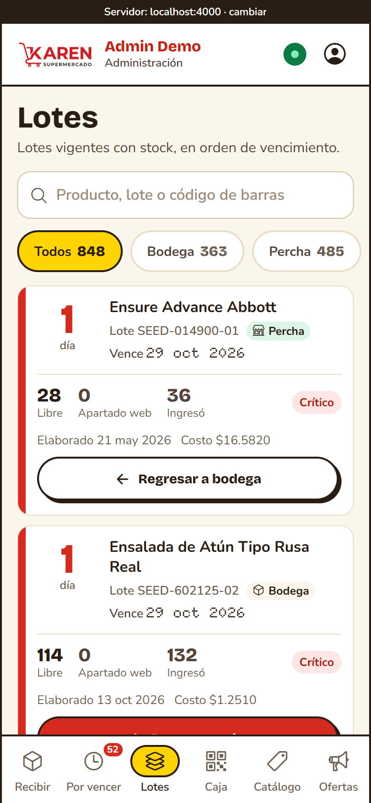<br><sub>App de bodega: inventario por lotes</sub> |
| 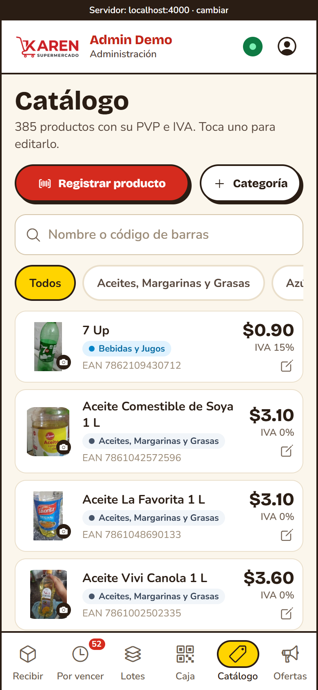<br><sub>App de bodega: catálogo de productos</sub> | 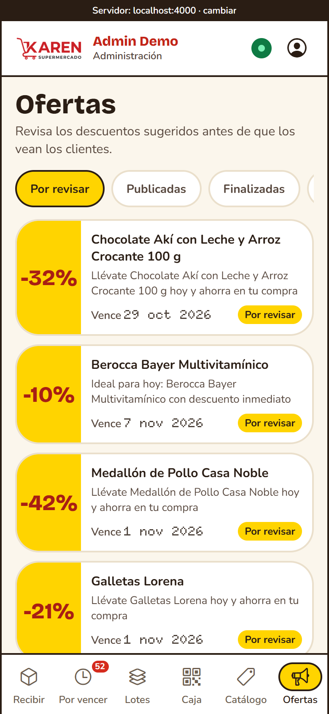<br><sub>App de bodega: revisión de ofertas generadas con IA</sub> |

---

## ✨ Características

- **Inventario por lotes con FEFO**: cada lote tiene fecha de caducidad, ubicación (bodega o percha) y saldo; las reservas toman primero lo que vence antes.
- **Semáforo de caducidad**: un lote se marca en rojo con menos de 7 días, en amarillo con menos de 15 y como vencido al llegar a 0, con alertas en tiempo real por Server-Sent Events.
- **Reservas con código de retiro**: el cliente aparta productos y recibe un código `KR-XXXXXX` y un pase con QR; el tiempo de retención se elige entre 30 minutos y 2 horas y se puede ampliar de 30 en 30 hasta 4 horas en total.
- **Protección contra sobreventa**: el stock se reserva con bloqueo en la base de datos y los límites de cada oferta se aplican con el lote bloqueado, de modo que reservas simultáneas nunca superan lo disponible.
- **Promociones con IA y aprobación humana**: el sistema propone el descuento y el texto de la oferta; un administrador la edita, le pone límites (por pedido, unidades y fecha de fin) y la aprueba. Usa OpenRouter como proveedor principal y Gemini como respaldo.
- **Tienda y portal independientes**: `store-api` corre en la PC de la tienda y sigue funcionando sin internet; `portal-api` corre en la nube y atiende a los clientes. La tienda siempre inicia la comunicación.
- **Tres interfaces**: portal web (PWA instalable), app móvil de clientes y app móvil de bodega, con modo claro y oscuro y diseño adaptado a tabletas.
- **Reportes**: movimientos, mermas y resumen del inventario, exportables a PDF y CSV con escape contra inyección de HTML y de fórmulas.
- **Fotos de producto optimizadas**: se comprimen al subirlas y se sirven como miniaturas de 160, 320 o 640 px con caché de larga duración.
- **Seguridad por defecto**: roles, JWT, límites de tasa, cabeceras con Helmet, revocación de tokens, y negativa a arrancar en producción con cuentas de demostración o secretos de ejemplo.

---

## 🧰 Tecnologías Utilizadas

- **Frontend**
  - Portal web: React 18, Vite 8, Tailwind CSS 4, TypeScript, PWA con service worker.
  - Apps móviles: React Native 0.86 con Expo 57, React 19, TypeScript, `expo-image`, `expo-camera`.
- **Backend**
  - Node.js ≥ 20, Express 4, `pg`, JWT (HS256), `bcryptjs`, Helmet, `sharp` (fotos) y Swagger UI.
  - IA: OpenRouter y Gemini (`@google/genai`).
- **Base de datos**
  - PostgreSQL 14, una base para la tienda y otra para el portal; en la nube, Supabase.
- **Pruebas**
  - Backend: `node:test` con `supertest`; portal web: Vitest y Testing Library; apps móviles: Jest con `jest-expo`; ESLint y comprobación de tipos con `tsc`.
- **Despliegue**
  - Docker y Docker Compose, Azure Container Apps para el portal, GitHub Actions para la integración continua y EAS para compilar las apps móviles.

---

## 🏗️ Arquitectura

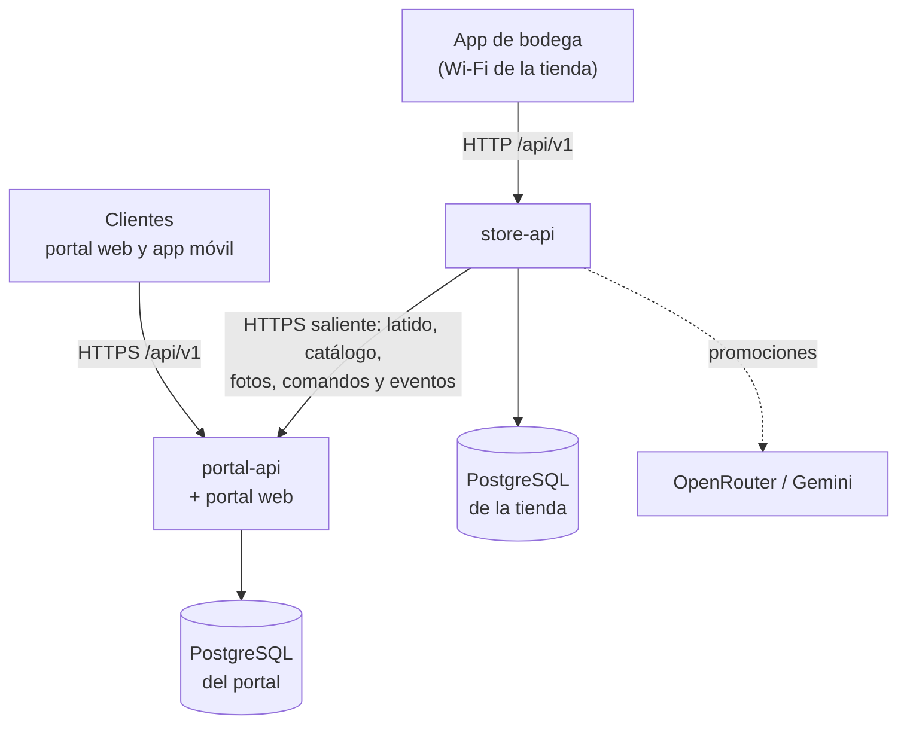

La tienda es la única autoridad sobre inventario y reservas; el portal guarda una copia de lectura del catálogo y una cola de reservas. Como la tienda siempre inicia la conexión (solo tráfico saliente), no se abre ningún puerto hacia la PC de la tienda. El diseño completo está en el [ADR-003](docs/decisions/ADR-003-split-store-portal.md).

| Pieza | Dónde corre | Habla con |
|---|---|---|
| `store-api` + su PostgreSQL | PC de la tienda (Docker) | el portal, saliendo por HTTPS |
| `portal-api` + portal web | Azure Container Apps | su PostgreSQL (Supabase) |
| App de bodega | Teléfonos del personal, en el Wi-Fi de la tienda | solo `store-api` |
| Portal móvil y portal web | Clientes, por internet | solo `portal-api` |

---

## 🗂️ Estructura del Proyecto

```bash
EcosistemaKaren/
├── backend/                        # API Node.js + Express (store-api y portal-api)
│   ├── index.js                    # monolito de transición (store + portal en un proceso)
│   ├── index.store.js              # arranque de store-api (puerto 4000)
│   ├── index.portal.js             # arranque de portal-api (puerto 4001)
│   ├── Dockerfile                  # imagen de producción (no corre como root)
│   ├── docker-compose.yml          # PostgreSQL y pgAdmin de desarrollo
│   ├── src/
│   │   ├── domain/                 # entidades, excepciones y políticas (BusinessRules.js)
│   │   ├── use-cases/              # auth, catálogo, categorías, lotes, productos, promociones, reservas
│   │   ├── adapters/               # controladores HTTP, repositorios PostgreSQL y adaptadores de IA
│   │   ├── apps/                   # composición de cada servicio (store, portal, shared)
│   │   └── infrastructure/         # db, http, seguridad, workers, outbox, sync, heartbeat, SSE, media
│   ├── init-db/                    # migraciones SQL: store/, portal/ y dev/ (datos de demostración)
│   ├── seed/                       # catalogo-ecuador.json para el seed masivo
│   ├── scripts/                    # create-user, seed y pruebas de humo, de errores y de extremo a extremo
│   └── test/                       # pruebas con node:test
├── frontend/
│   ├── portal-web-react/           # portal web de clientes (React + Vite + Tailwind, PWA)
│   ├── portal-mobile-reactnative/  # app móvil de clientes (Expo)
│   └── bodega-mobile-reactnative/  # app móvil del personal (Expo)
├── deploy/
│   ├── azure/                      # Dockerfile.portal y deploy.ps1 para Azure
│   └── tienda/                     # plantilla .env.store y scripts .bat de la PC de la tienda
├── dev/                            # splitEnv.js: variables del modo --split de start.js, con sus pruebas
├── docs/                           # operación, Azure, apps móviles, ADR, sistema visual y capturas/
├── screenshots/                    # capturas anteriores de la bodega y su script
├── .github/workflows/ci.yml        # integración continua
├── LICENSE                         # licencia MIT
├── docker-compose.prod.example.yml # despliegue de producción de store y portal
├── start.js                        # levanta todo el entorno de desarrollo con un comando
├── architecture.md                 # arquitectura limpia del backend
├── database.md                     # esquema de la base de datos
├── api-spec.md                     # especificación de la API
├── diseno_interfaces.md            # diseño de las interfaces
└── CLAUDE.md                       # flujo de trabajo Git y reglas del README
```

---

## 📋 Requisitos del Sistema

| Para | Necesitas |
|---|---|
| Desarrollo | Node.js ≥ 20 y npm; Docker (para PostgreSQL) |
| Apps móviles | Expo (se instala con `npm install`) y un teléfono o un emulador |
| Compilar las apps | Una cuenta de Expo para EAS (ver [docs/apps-moviles.md](docs/apps-moviles.md)) |
| Producción: portal | Cuenta de Azure con Container Apps y una base PostgreSQL (por ejemplo Supabase) |
| Producción: tienda | Una PC con Docker Desktop, IP fija en la red local y acceso saliente a internet |
| IA (opcional) | Una clave de OpenRouter o de Gemini para generar promociones |

---

## ⚙️ Instalación y Configuración

1. Clona el repositorio y entra a la carpeta:

   ```bash
   git clone https://github.com/kiramman-mp3/EcosistemaKaren.git
   cd EcosistemaKaren
   ```

2. Arranca el entorno de desarrollo. El script instala las dependencias, crea `backend/.env` a partir de `backend/.env.example`, levanta PostgreSQL, siembra datos de demostración si la base está vacía y arranca el backend, el portal web y Expo:

   ```bash
   node start.js
   ```

3. Si prefieres configurarlo a mano, copia las variables y edítalas:

   ```bash
   cp backend/.env.example backend/.env
   cd backend && npm install && npm run docker:up && npm run dev
   ```

4. Define al menos estas variables en `backend/.env` (la lista completa, con comentarios, está en `backend/.env.example`):

   | Variable | Para qué sirve |
   |---|---|
   | `DB_HOST`, `DB_PORT`, `DB_NAME`, `DB_USER`, `DB_PASSWORD` | Conexión a PostgreSQL de la tienda (`PORTAL_DB_*` para la del portal) |
   | `JWT_SECRET` | Firma de las sesiones; debe ser largo y aleatorio |
   | `STORE_SERVICE_KEY`, `PORTAL_URL` | Clave compartida y URL del portal para la sincronización de la tienda |
   | `OPENROUTER_API_KEY`, `GEMINI_API_KEY` | Claves de IA para promociones (opcionales) |
   | `CORS_ORIGINS`, `TRUST_PROXY_HOPS` | Orígenes permitidos y saltos de proxy en producción |

> [!WARNING]
> Los secretos (`JWT_SECRET`, claves de IA, contraseñas de base de datos y `STORE_SERVICE_KEY`) **nunca se guardan en el repositorio**. Viven en `.env`, que está ignorado por git, o en las variables de la plataforma de despliegue.

---

## ▶️ Uso y Ejecución

### Desarrollo local

```bash
node start.js                    # monolito: dependencias, .env, PostgreSQL, datos de demostración, backend, web y Expo
node start.js --setup            # solo prepara (dependencias, .env y base de datos) y termina
node start.js --mobile=portal    # solo el Expo del portal móvil (también: bodega, all, none)
node start.js --no-seed          # no siembra datos aunque la base esté vacía
node start.js --split            # igual, pero con store-api y portal-api separados, cada uno con su base
node start.js --backend-tienda   # solo la base y store-api (puerto 4000), para probar la app de bodega
node start.js --down             # detiene PostgreSQL y pgAdmin
```

`--backend-tienda` imprime la URL que deben usar las apps de bodega (`http://<IP de la PC>:4000/api/v1`) y, con `--portal-url=https://<portal>`, conecta además la tienda a ese portal. Usa la base de desarrollo con cuentas de contraseña conocida: **no es el despliegue de la tienda real** (ese es `deploy/tienda/`).

Cuentas de demostración (solo desarrollo): `cliente@karen.com`, `bodega@karen.com` y `admin@karen.com`, todas con la contraseña `demo123`. El seed masivo (`npm run db:seed` en `backend/`) crea otras con `@demo.karen.ec` y la contraseña `Karen2026*`.

Puertos por defecto: `store-api` 4000, `portal-api` 4001, portal web 5175, PostgreSQL de desarrollo 5433 (portal 5434) y pgAdmin 5051.

### Producción local

```bash
cd backend && npm start              # monolito con las variables de backend/.env
npm run start:store                  # solo store-api
npm run start:portal                 # solo portal-api
```

### Scripts disponibles

| Dónde | Comando | Qué hace |
|---|---|---|
| Raíz | `npm start` / `npm run setup` / `npm run down` | Equivalen a `node start.js`, `node start.js --setup` y `node start.js --down` |
| Raíz | `npm test` | Pruebas del orquestador de desarrollo (`dev/`) |
| `backend/` | `npm run dev`, `dev:store`, `dev:portal` | Arranque con recarga automática |
| `backend/` | `npm test` | Todas las pruebas del backend |
| `backend/` | `npm run lint` / `lint:fix` | ESLint |
| `backend/` | `npm run docker:up` / `docker:down` | PostgreSQL y pgAdmin de desarrollo |
| `backend/` | `npm run db:seed` | Seed masivo con el catálogo de Ecuador, lotes, reservas y promociones |
| `backend/` | `npm run user:create` | Crea un usuario de personal (el personal no se registra por la API) |
| `backend/` | `npm run test:migrations` | Verifica que las migraciones dejan el esquema esperado y se pueden aplicar dos veces |
| `backend/` | `npm run test:services` | Prueba de humo de los servicios y sus rutas |
| `backend/` | `npm run test:http-errors` | Sondeos de robustez: ningún dato inválido debe producir un 500 |
| `backend/` | `npm run test:e2e-split` | Prueba de extremo a extremo de tienda y portal como dos procesos |
| `backend/` | `npm run test:endpoints`, `test:performance` | Recorrido de la API y medición de latencia contra un backend en marcha |
| `frontend/portal-web-react/` | `npm run dev` / `build` / `preview` | Servidor de desarrollo, compilación de producción y vista previa |
| `frontend/portal-web-react/` | `npm test`, `lint`, `typecheck` | Vitest, ESLint y comprobación de tipos |
| Apps móviles | `npm start`, `android`, `ios`, `web` | Expo |
| Apps móviles | `npm test`, `npm run typecheck` | Jest y comprobación de tipos |

### Pruebas

El proyecto tiene 571 pruebas automáticas: 363 en el backend, 74 en el portal web, 63 en el portal móvil, 57 en la app de bodega y 14 en el orquestador. Las del backend que usan la base de datos se omiten si no hay PostgreSQL disponible.

```bash
cd backend && npm test && npm run lint
cd frontend/portal-web-react && npm test && npm run lint && npm run build
cd frontend/portal-mobile-reactnative && npm test && npm run typecheck
cd frontend/bodega-mobile-reactnative && npm test && npm run typecheck
npm test    # en la raíz
```

---

## 🚀 Despliegue

| Qué | Dónde |
|---|---|
| Portal (API + web) en Azure Container Apps, con la base en Supabase | [docs/azure.md](docs/azure.md) y `deploy/azure/deploy.ps1` |
| PC de la tienda: variables, arranque y respaldos | `deploy/tienda/` y [docs/azure.md](docs/azure.md) |
| Operación: secretos, proxy, sondas y respaldos | [docs/operacion.md](docs/operacion.md) |
| Compilar las apps móviles con EAS | [docs/apps-moviles.md](docs/apps-moviles.md) |

El portal se publica con `deploy/azure/deploy.ps1`; la tienda se levanta con `deploy/tienda/Iniciar-Karen.bat` a partir de `deploy/tienda/.env.store.example`. El compose de ejemplo (`docker-compose.prod.example.yml`) se valida en el CI.

Variables que hay que definir en la plataforma:

| Servicio | Variables |
|---|---|
| Portal | `PORTAL_DB_HOST`, `PORTAL_DB_PORT`, `PORTAL_DB_NAME`, `PORTAL_DB_USER`, `PORTAL_DB_PASSWORD`, `PORTAL_JWT_SECRET`, `PORTAL_CORS_ORIGINS`, `PORTAL_TRUST_PROXY_HOPS`, `STORE_SERVICE_KEY` |
| Tienda | `DB_NAME`, `DB_USER`, `DB_PASSWORD`, `STORE_JWT_SECRET`, `STORE_SERVICE_KEY`, `PORTAL_URL`, `STORE_BIND`, `STORE_CORS_ORIGINS`, `STORE_TRUST_PROXY_HOPS` y, para la IA, `GEMINI_API_KEY` |

Con una base en la nube, activa `DB_SSL=true` y, si el proveedor firma con su propia CA (Supabase), define `DB_SSL_CA`. Con un pooler usa el modo de sesión (puerto 5432), no el de transacción.

Las apps móviles se compilan con EAS (`npx eas-cli build -p android --profile android-apk` y `npx eas-cli build -p ios -e ios-altstore`); son builds de prueba, no de tienda de aplicaciones.

---

## 🔍 Detalles Técnicos

### Roles

| Rol | Servicio | Qué hace |
|---|---|---|
| `CLIENTE` | portal-api | Se registra solo, consulta el catálogo y las ofertas, reserva y cancela |
| `BODEGUERO`, `PERCHERO` | store-api | Ingresan lotes, mueven stock y confirman reservas en caja |
| `ADMIN` | store-api | Todo lo anterior, más productos, categorías, promociones y usuarios |

El portal web solo admite clientes: el personal ingresa por la app de bodega con token Bearer.

### Sincronización entre tienda y portal

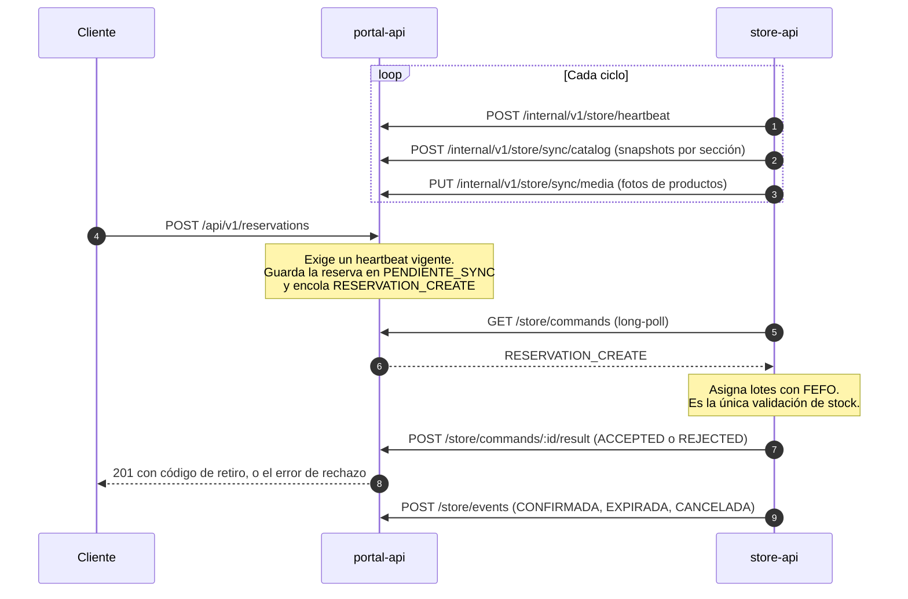

Si la tienda tarda más de 8 s en contestar, el portal responde `202` y el cliente consulta después. Sin latido vigente el portal no acepta reservas (`503`). El detalle, con estados, reintentos e idempotencia, está en el [ADR-003](docs/decisions/ADR-003-split-store-portal.md).

### API

Prefijo `/api/v1`. La especificación completa, con cuerpos y respuestas, está en [api-spec.md](api-spec.md); con `SWAGGER_ENABLED` también hay documentación interactiva.

| Grupo | Endpoints | Quién |
|---|---|---|
| Autenticación | `POST /auth/register`, `POST /auth/login`, `GET /auth/me`, `POST /auth/logout` | Público y sesión |
| Catálogo | `GET /categories`, `GET /products`, `GET /products/barcode/:barcode`, `GET /availability`, `GET /catalog/status` | Público |
| Productos | `POST /categories`, `POST /products`, `PUT` y `PATCH /products/:id`, `GET /products/:id/price-history`, `PUT /products/:id/image` | `ADMIN` |
| Lotes e inventario | `GET` y `POST /lots`, `PATCH /lots/:id/location`, `POST /lots/:id/merma`, `GET /inventory/movements`, `/inventory/wastes`, `/inventory/summary` | `BODEGUERO`, `PERCHERO`, `ADMIN` (ingresar lotes: `BODEGUERO`, `ADMIN`) |
| Reservas | `POST /reservations`, `GET /reservations/user/:userId`, `POST /reservations/:id/extend`, `POST /reservations/:id/cancel` | `CLIENTE` y propietario |
| Caja | `GET /reservations/code/:code`, `POST /reservations/:id/confirm` | `BODEGUERO`, `ADMIN` |
| Alertas | `GET /alerts`, `PATCH /alerts/:id/atender`, `GET /alerts/stream` (SSE) | Personal |
| Promociones | `POST /promotions/generate`, `GET /promotions`, `/promotions/pending`, `/promotions/manage`, `PATCH /promotions/:id`, `POST /promotions/:id/approve`, `/reject`, `/deactivate`, `DELETE /promotions/:id`, `GET /metrics/ai` | Personal y `ADMIN` |
| Estado | `GET /heartbeat` | Público |

### Reglas de negocio

| Regla | Valor | Dónde |
|---|---|---|
| Semáforo de caducidad | Vencido ≤ 0 días, rojo < 7, amarillo < 15, normal desde 15 | `BusinessRules.js` y [ADR-001](docs/decisions/ADR-001-politica-reservas-caducidad.md) |
| Duración de una reserva | 30 minutos por defecto; la API acepta de 15 a 240 minutos y las apps ofrecen 30, 45, 60, 90 o 120 | `BusinessRules.js`, `requestSchemas.js` y [ADR-002](docs/decisions/ADR-002-ttl-reservas-30-minutos.md) |
| Ampliación | +30 minutos por vez, solo el dueño o un `ADMIN`, con tope de 4 horas desde la creación | `BusinessRules.js` |
| Límites de una oferta | `limitePorPedido`, `stockOferta` y `vigenteHasta`, validados al editar y al aprobar | [api-spec.md](api-spec.md) |
| Reservas sin tienda | Sin un latido vigente de la tienda el portal responde `503` | `HEARTBEAT_TIMEOUT_SECONDS` |
| Aprobación de promociones | Solo se muestran a los clientes las aprobadas por un `ADMIN` | [api-spec.md](api-spec.md) |

### Capas del backend

La dependencia va de afuera hacia adentro: las capas internas no conocen a las externas (detalle en [architecture.md](architecture.md)).

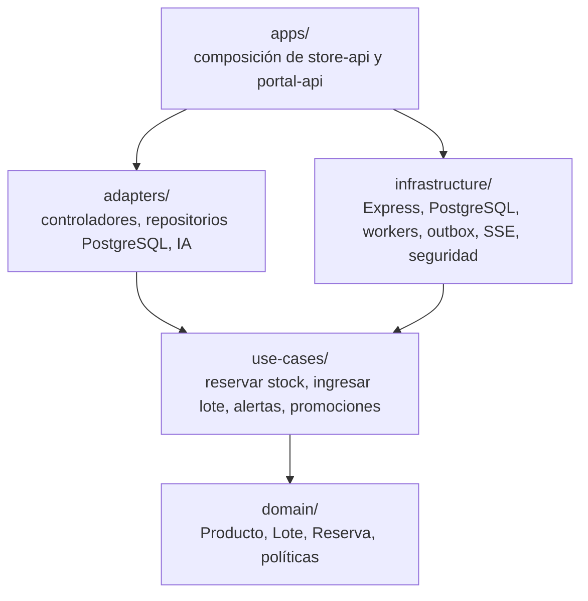

### Procesos en segundo plano

| Servicio | Workers |
|---|---|
| `store-api` | `HeartbeatSenderWorker`, `CatalogSyncWorker`, `MediaSyncWorker`, `CommandPollerWorker`, `OutboxFlusherWorker`, `LotExpiryWorker`, `ReservationCleanerWorker`, `MaintenanceWorker` |
| `portal-api` | `PortalReservationSweeperWorker`, `MaintenanceWorker` |

### Migraciones

Los archivos SQL se aplican en orden al arrancar cada servicio (`backend/src/infrastructure/db/migrations.js`) y su resultado se verifica con `npm run test:migrations`.

| Carpeta | Archivos | Contenido |
|---|---|---|
| `backend/init-db/store/` | `01` a `14` | Esquema inicial, aprobación de promociones, trazabilidad del inventario, imagen y búsqueda de productos, latido y límites de tasa, revocación de tokens, clientes remotos y outbox, historial de precios y límites de ofertas |
| `backend/init-db/portal/` | `01` a `07` | Esquema del portal, espejo del catálogo, reservas, espejo de fotos, ampliación de reservas, ventas por producto y límites de promociones |
| `backend/init-db/dev/` | `01-demo-data.sql` | Cuentas y datos de demostración; **solo desarrollo**, nunca en producción |

### Diseño

El aspecto visual (colores, tipografía, radios y movimiento) está en [docs/sistema-visual.md](docs/sistema-visual.md); la separación de interfaces, en [diseno_interfaces.md](diseno_interfaces.md); y las pruebas de aceptación de la bodega y en teléfono, en [docs/UAT-bodega.md](docs/UAT-bodega.md) y [docs/verificacion-telefono.md](docs/verificacion-telefono.md).

### Lo que queda por confirmar

- Las **apps móviles** se compilan como builds de prueba (permiten HTTP en la red local y elegir el servidor desde la app); publicarlas en Google Play o en la App Store requiere cuentas de pago y builds de tienda.
- Las dos apps móviles conservan 4 avisos de severidad alta de `npm audit` sin versión corregida, todos por `node-forge`; el detalle y su alcance están en [docs/dependencias.md](docs/dependencias.md).
- Una prueba del backend (`reservation-extension-db.test.js`) falló una vez dentro de la suite completa contra PostgreSQL real y pasa sola: otra prueba ejecuta el barrido global de expiración sobre la misma base mientras corren en paralelo.

---

## 🗺️ Roadmap de Funcionalidades

- [x] Inventario por lotes con FEFO, semáforo de caducidad y alertas en tiempo real
- [x] Reservas con código de retiro, tiempo elegible y ampliación
- [x] Límites por oferta y bloqueo contra sobreventa
- [x] Promociones con IA y aprobación humana, con respaldo entre proveedores
- [x] Separación en `store-api` y `portal-api`, con sincronización de catálogo y fotos
- [x] Portal web instalable (PWA), app móvil de clientes y app móvil de bodega
- [x] Reportes de movimientos y mermas en PDF y CSV
- [x] Fotos comprimidas, miniaturas y caché de larga duración
- [x] Integración continua con pruebas, lint, auditoría, migraciones y comprobación de la imagen Docker
- [x] Despliegue del portal en Azure y de la tienda en una PC con Docker
- [x] Licencia MIT
- [ ] Publicar las apps móviles en Google Play y en la App Store
- [ ] Aislar la prueba intermitente `reservation-extension-db.test.js` cuando corre en paralelo con otras
- [ ] Resolver los avisos de `node-forge` cuando exista una versión corregida

---

## 👥 Contribuidores

| Contribuidor | Commits |
|---|---:|
| kiramman-mp3 | 362 |
| JoseM151 | 76 |
| Johan Rodríguez | 44 |
| carol104 | 18 |
| Manuel | 9 |
| Ramírez Hinostroza Manuel Eduardo | 3 |
| Carol Isabel Cañizares Villacís | 2 |

Datos de `git shortlog -sn` al editar este README (incluyen los commits de integración). Los commits siguen [Conventional Commits](https://www.conventionalcommits.org/es/); el flujo de ramas está en [CLAUDE.md](CLAUDE.md): `main` (estable), `develop` (desarrollo) y ramas `feature/*`, `fix/*`, `refactor/*`, `chore/*` y `docs/*`.

---

## 📚 Fuentes y Referencias

<details>
<summary>Ver fuentes</summary>

- [ADR-001](docs/decisions/ADR-001-politica-reservas-caducidad.md), [ADR-002](docs/decisions/ADR-002-ttl-reservas-30-minutos.md) y [ADR-003](docs/decisions/ADR-003-split-store-portal.md): decisiones de arquitectura.
- [architecture.md](architecture.md), [database.md](database.md), [api-spec.md](api-spec.md) y [diseno_interfaces.md](diseno_interfaces.md): diseño del sistema.
- [docs/operacion.md](docs/operacion.md), [docs/azure.md](docs/azure.md) y [docs/apps-moviles.md](docs/apps-moviles.md): operación, despliegue y compilación.
- [Open Food Facts](https://world.openfoodfacts.org): origen de las imágenes del catálogo de demostración.
- [Expo](https://docs.expo.dev), [React Native](https://reactnative.dev), [Express](https://expressjs.com), [PostgreSQL](https://www.postgresql.org/docs/14/), [OpenRouter](https://openrouter.ai/docs) y [Gemini API](https://ai.google.dev/gemini-api/docs): documentación de las tecnologías usadas.

</details>

---

## 📄 Licencia

Este proyecto se distribuye bajo la licencia MIT. Consulta el archivo [LICENSE](LICENSE) para ver el texto completo.

---

## ✍️ Autor

**kiramman-mp3**
